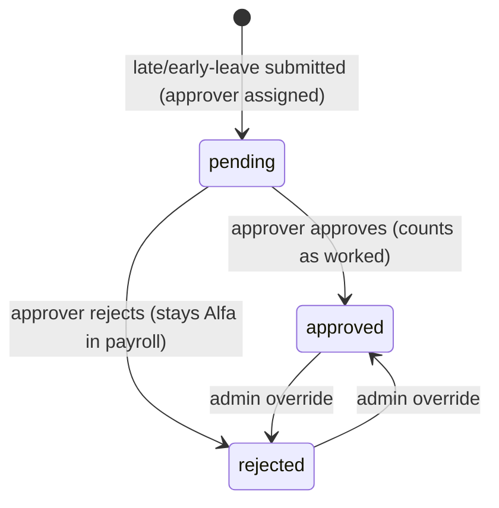
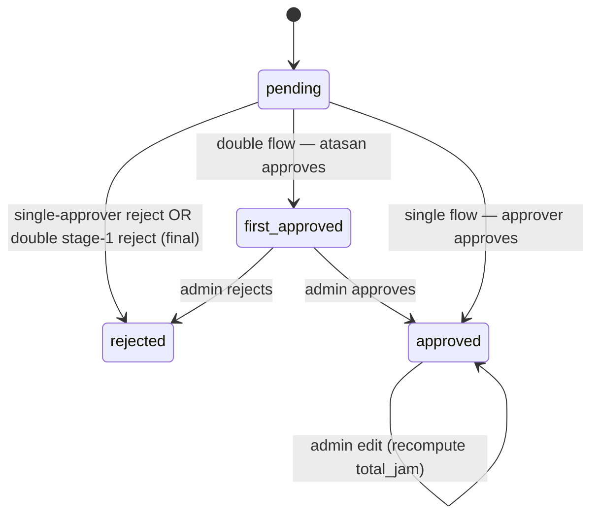
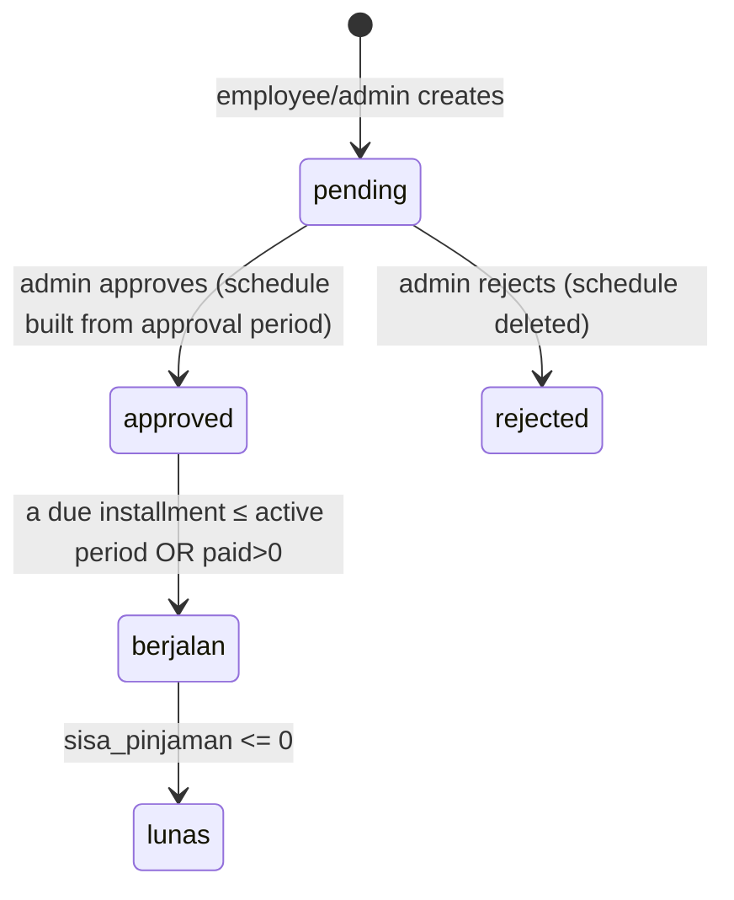
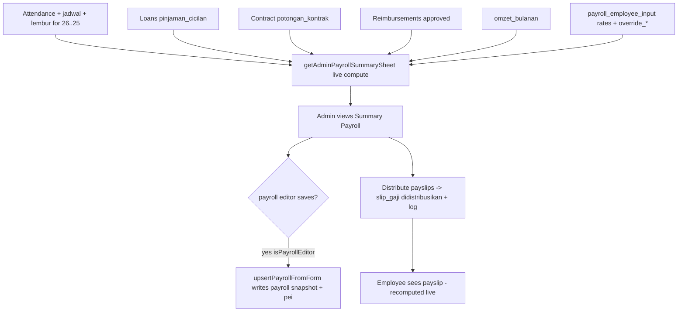
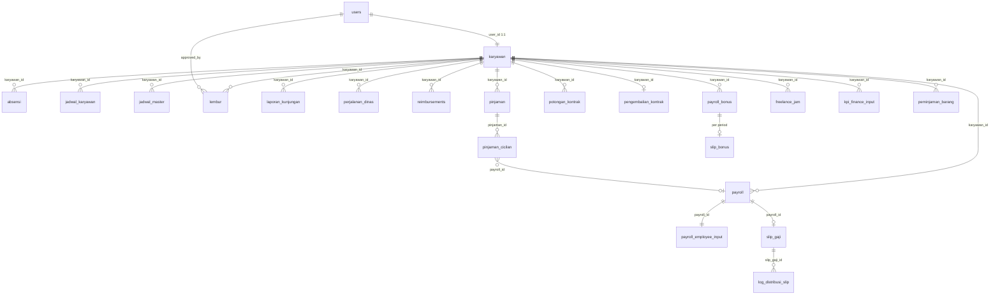
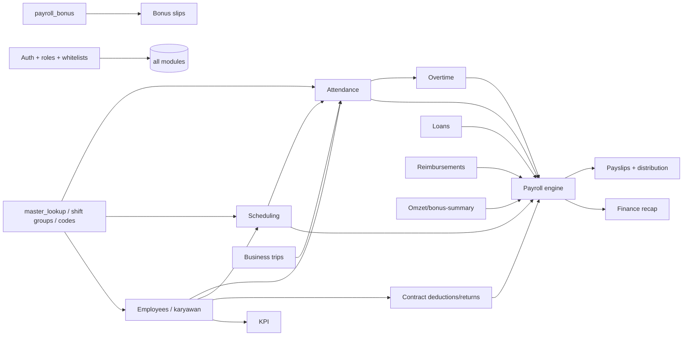

# HR MANAGEMENT SYSTEM — AYRES / AVA Group
## Complete System Audit & Technical Documentation

> **Purpose.** Reverse-engineering / knowledge-transfer reference for the existing HR Management System at `C:\new-hr\web_hr-main`, produced by static source analysis (no files in the audited project were modified). It lets a new developer rebuild the entire frontend (UI/UX) **without losing any function, business rule, workflow, role, permission, or integration**.
>
> **Evidence standard.** Non-trivial claims cite `file:line`. Uncertainties are marked `UNVERIFIED` / `NEEDS INVESTIGATION`. Per-feature verification status is one of: `VERIFIED FROM CODE`, `VERIFIED BY TEST`, `NOT VERIFIED`, `NEEDS INVESTIGATION`. **No automated tests exist** (§14), so nothing is `VERIFIED BY TEST`.
>
> **Audit date:** 2026-11-24. **Scope:** `C:\new-hr\web_hr-main` only. The outer `C:\new-hr` is an unrelated fresh Create-Next-App scaffold that merely hosts this document.
>
> **Method note.** This document was assembled from a foundation pass plus five parallel deep-dive module audits; every cross-module finding was reconciled for consistency.

---

## Table of Contents

1. [Executive Summary](#1-executive-summary)
2. [Project Overview](#2-project-overview)
3. [System Architecture](#3-system-architecture)
4. [Module Inventory](#4-module-inventory)
5. [Business Process Documentation](#5-business-process-documentation)
6. [User Roles & Permissions](#6-user-roles--permissions)
7. [Database Documentation](#7-database-documentation)
8. [API Documentation](#8-api-documentation)
9. [Frontend Documentation](#9-frontend-documentation)
10. [Business Logic](#10-business-logic)
11. [Security Audit](#11-security-audit)
12. [Technical Debt](#12-technical-debt)
13. [Module Dependencies](#13-module-dependencies)
14. [Testing & Verification](#14-testing--verification)
15. [Redesign Preparation](#15-redesign-preparation)
16. [Known Issues & Investigation Backlog](#16-known-issues--investigation-backlog)
17. [Complete Feature Checklist](#17-complete-feature-checklist)

---

## 1. Executive Summary

**AYRES / AVA Group HR Management System** is a payroll-centric Human Resources web application for an Indonesian apparel/retail company ("AVA Sportivo", "Ayres Apparel", with a "Toko Solo" branch and a "JNE" logistics unit). It manages the full employee lifecycle: master data, geofenced selfie attendance, shift scheduling, overtime, leave/permission codes, business trips, reimbursements, loans with installment schedules, item loans, sales visit reports, per-division KPI scoring, and a multi-track payroll engine that produces distributable salary and bonus slips.

- **Account roles:** `admin` (HR/Finance back office), `karyawan` (employee self-service), `spv` (supervisor — scheduling/approval). A second, finer authorization layer derives from the employee's **job title** (`karyawan.jabatan`) and from hardcoded email/name whitelists (§6).
- **Technology:** Next.js 16 (App Router) full-stack · React 19 (Server + Client Components) · **raw MySQL via `mysql2`** (no ORM) · Tailwind CSS v4 · Excel (`exceljs`) + PDF (`jspdf`) export · a three.js login background · an **Ollama** LLM powering an in-app "HR Agent" chat.
- **Companion mobile app:** a separate native (Expo/React Native) employee app consumes the same backend via Bearer-token auth (`/api/mobile/login` + `/api/employee/*`; see `BACKEND_CHANGES.md` and §8).
- **Deployment:** Hostinger (anti-cache headers reference its CDN "hcdn"), MariaDB 10.4 / MySQL, `utf8mb4`.

**Scale:** ~225 source files — 66 page routes (`app/**/page.tsx`), 77 API handlers (`app/api/**/route.ts`), ~65 React components, ~70 business-logic modules (`lib/*.ts`, ~20k LOC). Largest logic modules: `lib/hris.ts` (1841), `lib/loans.ts` (1720), `lib/payroll-admin.ts` (1576), `lib/payroll-summary.ts` (1490), `lib/employees.ts` (1213).

**Five facts to understand before any change:**

1. **No middleware.** There is no `middleware.ts`. Every page enforces `requireAdminSession()` / `requireEmployeeSession()` / `requireSpvSession()`, and every API handler calls `getCurrentXxxSession()` → `if (!session) 401`. Two pages ship with **no** guard (`app/admin/master/page.tsx` — a redirect; `app/spv/page.tsx` — a redirect). (§11)
2. **Schema drift / self-bootstrapping DDL.** The committed dump `db/hris_payroll_app_v2.sql` defines **20** tables; the code uses **~50**. ~30 tables (and dozens of columns) are created lazily at runtime via `CREATE TABLE IF NOT EXISTS` / `ensureXxxSchema()` / `ALTER TABLE` inside `lib/*`, frequently **on the read path**. Three migration-bookkeeping tables coexist (`app_migrations`, `hris_migration_log`, `schema_migrations`). There is **no single source-of-truth schema**. (§7, §12)
3. **Payroll is recomputed live on every read.** The `payroll` table and `slip_gaji` are **not** the display source of truth — `getAdminPayrollSummarySheet` / `getPenjahitSheet` / `getPartimeSheet` / `getFreelanceSheet` recompute from attendance + inputs on each view, including the employee's own payslip. A save-path (`upsertPayrollFromForm`) writes a **divergent** snapshot that no longer reconciles with the live numbers. (§10, §12)
4. **Business rules are specific, dated, and volatile.** `REVISI.md` is a Sep–Oct 2026 changelog of fine-grained rules (BPJS 25k→35k auto-migration, kerajinan forced to 10% of monthly base, penjahit weekly payout fixed Rp500.000 weeks 1–3, partime exempt from contract deductions, JNE unit gets no kerajinan, "Leader" jabatan may approve via Master Jabatan, late tolerance effectively 0). These must be preserved verbatim (§10, §15).
5. **Authorization is multi-source and partly hardcoded.** Account role + job title + hardcoded email whitelists (`OVERTIME_APPROVER_EMAILS`, `HRD_SUPER_EDITOR_EMAILS`) + a DB whitelist (`payroll_editor`) + a name whitelist (`"Fara Ais Umainah"`). Menu visibility ≠ authorization. (§6)

**Headline risk findings** (details §11): default session secret falls back to a public constant in production (CRITICAL); any admin can self-grant payroll-edit rights via `/api/admin/payroll-editors` (CRITICAL); HR-Agent LLM can read the `users` table (unsalted password hashes) despite a schema whitelist (HIGH); uploads serving route has no per-record ownership check — IDOR (HIGH); open self-registration with no verification (HIGH); unsalted SHA-256 passwords (HIGH); GPS/geofence fully client-trusted (HIGH).

---

## 2. Project Overview

### 2.1 Technology Stack (evidence: `package.json`)

| Layer | Technology | Version | Notes |
|---|---|---|---|
| Framework | Next.js | `16.1.6` | App Router; full-stack. `build` = `next build --webpack`. |
| UI runtime | React / React DOM | `19.2.3` | Server Components for data pages; Client Components (`"use client"`) for interactive managers. |
| Language | TypeScript | `^5` | `strict:true`, path alias `@/* → ./*` (`tsconfig.json`). |
| DB driver | `mysql2` | `^3.19.1` | Raw SQL, shared pool, `namedPlaceholders`; **no ORM**. |
| CSS | Tailwind CSS | `^4` | via `@tailwindcss/postcss` (`postcss.config.mjs`). |
| Excel | `exceljs` | `^4.4.0` | Employee / finance / item-loan exports. |
| PDF | `jspdf` + `jspdf-autotable` | `^4.2.0` / `^5.0.8` | Payslip + THP-before-deduction exports (client-side). |
| 3D | `three` + `postprocessing` | `^0.183.2` | Animated login background (`components/GridScan.tsx`). |
| LLM | Ollama Cloud (HTTP) | — | HR Agent; `OLLAMA_HOST`/`OLLAMA_KEY`/`OLLAMA_MODEL` (default model `gpt-oss:120b-cloud`). |
| Lint | ESLint + `eslint-config-next` | `^9` / `16.1.6` | `eslint.config.mjs`. |

Runtime per dump header: **MariaDB 10.4.32**, originally administered via phpMyAdmin.

### 2.2 Directory Structure & Responsibilities

```
web_hr-main/
├─ app/                      # Next.js App Router: pages + API
│  ├─ page.tsx               # Public landing = unified login (role-routed). No guard.
│  ├─ layout.tsx             # Root layout (lang="id", ConfirmDialogProvider, iOS-Safari bfcache hack)
│  ├─ globals.css            # Tailwind v4 theme (AYRES red/maroon palette; inline hex, no token system)
│  ├─ error.tsx / global-error.tsx   # Error boundaries (console.error + link to /)
│  ├─ admin/                 # ~40 admin back-office pages (require admin session)
│  │  ├─ layout.tsx          # force-dynamic; passthrough (NO extra guard)
│  │  ├─ page.tsx            # Admin dashboard (stat cards + quick links)
│  │  └─ <module>/page.tsx
│  ├─ employee/              # ~20 self-service pages (require employee session)
│  ├─ spv/                   # ~7 supervisor pages (require spv session; layout is passthrough)
│  └─ api/                   # 77 route handlers (admin/*, employee/*, spv/*, auth, uploads, mobile)
├─ components/               # ~65 client components ("*Manager"/"*Sheet" per feature) + 3 Shells
├─ lib/                      # ~70 modules: DB access, auth, calculations, schema-ensure DDL
├─ db/
│  ├─ hris_payroll_app_v2.sql   # Base dump (20 tables + sample data) — partial vs runtime schema
│  ├─ migrations/            # dated one-off data fixes (e.g. 2026-10-23-bpjs-25k-to-35k.sql)
│  └─ diagnostics/           # ad-hoc check queries
├─ database/                 # Older/alternate dumps + ALTERs + seed (LEGACY — see §12)
├─ docs/                     # REVISI dated notes
├─ scripts/seed-admins.mjs   # Seeds two admins with a hardcoded password (§11)
├─ public/                   # logos, signatures (ttd/), AND committed sample uploads/ (§11)
├─ Flow/ABSENSI.drawio.png   # attendance flow diagram (image)
├─ REVISI.md                 # dated business-rule changelog (intent; verify vs code)
├─ BACKEND_CHANGES.md        # mobile Bearer-token API addendum
├─ docspenjahit.md           # tailor payroll rules summary
├─ README.md                 # prior Indonesian docs (55KB) — not relied upon
└─ next.config.ts            # rewrite /uploads/:path* → /api/uploads/:path*
```

**Layer responsibilities:**
- **`app/**/page.tsx`** — mostly Server Components: call `requireXxxSession()` (redirect `/` if unauthenticated), query `lib/*` directly, render a `*Manager`/`*Sheet` client component inside the role Shell.
- **`app/api/**/route.ts`** — JSON endpoints for client mutations + the mobile app; each resolves a session and returns 401 when absent.
- **`components/*`** — Client Components (tables/forms/modals) calling API routes via `fetch`; the three Shells render the sidebar nav.
- **`lib/*`** — the real system: `db.ts` (pool), `auth.ts` (sessions), one module per domain concept holding its schema-ensure DDL, queries, and formulas.

### 2.3 Environment Configuration

| Variable | Used in | Purpose | Default / risk |
|---|---|---|---|
| `DB_HOST` | `lib/db.ts:19` | MySQL host | default `127.0.0.1` |
| `DB_PORT` | `lib/db.ts:20` | MySQL port | default `3306` |
| `DB_USER` | `lib/db.ts:21` | MySQL user | default `root` |
| `DB_PASSWORD` | `lib/db.ts:22` | MySQL password | **default `""`** |
| `DB_NAME` | `lib/db.ts:23` | Database name | default `hris_payroll_app_v2` |
| `APP_SESSION_SECRET` | `lib/auth.ts:33,40` | HMAC secret for sessions + mobile tokens | **default `dev-web-hr-session-secret`; only `console.warn` in prod, never throws — CRITICAL** |
| `NODE_ENV` | `lib/db.ts:41`, `lib/auth.ts:33,122…` | env mode | controls cookie `secure`, pool caching |
| `OLLAMA_HOST` | `lib/hr-agent.ts:5` | LLM endpoint | default `https://ollama.com` |
| `OLLAMA_KEY` | `lib/hr-agent.ts:6` | LLM bearer key | default `""` → agent disabled |
| `OLLAMA_MODEL` | `lib/hr-agent.ts:7` | LLM model | default `gpt-oss:120b-cloud` |
| `UPLOAD_DIR` | `lib/uploads.ts:9` | Upload storage root | default resolves under `public/uploads` (static-bypass risk, §11) |
| `SMTP_HOST/PORT/USER/PASS/FROM` | `README.md:821` only | documented for OTP email | **not referenced in code — dead** |

No `.env*` committed (`.gitignore` ignores `.env*`). `scripts/seed-admins.mjs:3-7` seeds admins `avafamily17@gmail.com` / `avagrouphrd@gmail.com` with hardcoded password `nakula1705` (HIGH, §11).

### 2.4 Setup (reconstructed; exact deploy `NEEDS INVESTIGATION`)

1. `npm install`
2. Create MySQL DB, import `db/hris_payroll_app_v2.sql` (base 20 tables). Remaining ~30 tables auto-create on first use of their feature.
3. Create `.env.local` with `DB_*`, `APP_SESSION_SECRET`, `OLLAMA_*`, optionally `UPLOAD_DIR`.
4. Optional: `node --env-file=.env.local scripts/seed-admins.mjs`.
5. `npm run dev` / `npm run build` + `npm run start`.

---

## 3. System Architecture

### 3.1 High-level request flow

```mermaid
flowchart TD
  subgraph Clients
    W[Web browser]
    M[Mobile app Expo/RN]
  end
  W -->|signed cookie| N[Next.js 16 App Router]
  M -->|Authorization: Bearer token| N
  N --> P{Route type}
  P -->|page.tsx Server Component| SC[requireXxxSession -> lib/* queries -> render Shell + Manager]
  P -->|api/**/route.ts| API[getCurrentXxxSession -> 401 if none -> lib/* -> JSON]
  SC --> LIB[lib/* domain modules]
  API --> LIB
  LIB --> POOL[(mysql2 pool lib/db.ts)]
  POOL --> DB[(MySQL / MariaDB)]
  API -. serves .-> UP[/api/uploads/[...path] -> resolveUploadPath -> fs/]
  API -. LLM .-> OLL[Ollama HTTP]
```

**Web page lifecycle:** e.g. `/admin/loans` → `app/admin/loans/page.tsx` (Server Component) runs `requireAdminSession()` → queries `lib/loans.ts` → renders `<AdminShell>` + `<AdminLoansManager>` (client) → that component `fetch`es `/api/admin/loans*` → each handler re-checks the session and calls `lib/loans.ts`.

**Mobile lifecycle:** `POST /api/mobile/login` → Bearer `token` (same signed-session format, 30-day `exp`) → `GET /api/employee/*` with `Authorization: Bearer <token>`; `getCurrentEmployeeSession()` falls back to the header when no cookie (`lib/auth.ts:128-145`).

### 3.2 Authentication & Session (`lib/auth.ts`, `app/api/login/route.ts`)

- **Credential check.** `POST /api/login` finds the user by lowercased email (LEFT JOIN `karyawan`), then compares `SELECT SHA2(?,256)` of the input against `users.password` (`app/api/login/route.ts:74-82`). Passwords are **unsalted SHA-256** (same in `lib/admins.ts:102,129`, `lib/employees.ts:757…`). Compare is `!==` (non-constant-time; low impact on a digest).
- **Session token.** `createSignedSession(payload)` = `base64url(JSON) + "." + HMAC_SHA256(payload, secret)` (`lib/auth.ts:43-63`) — **signed, not encrypted**; the payload (id/email/fullName) is readable by anyone. Verified with `timingSafeEqual` (`:65-99`).
- **Cookies.** Three httpOnly cookies — `web_hr_admin_session`, `web_hr_employee_session`, `web_hr_spv_session` — `sameSite=lax`, `secure` only in prod, `maxAge=8h` (`:116-205`). Login clears all three first (`login/route.ts:85`).
- **Role routing:** `admin → /admin`, `spv → /spv/jadwal`, `karyawan → /employee/check-in` (+ `showPayrollGreeting` when Jakarta day-of-month = 1) (`login/route.ts:87-133`).
- **Employee gating:** `requireEmployeeSession()` deletes the cookie + redirects if `karyawan.status_data='nonaktif'` (`auth.ts:147-166`); login also blocks nonaktif (`login/route.ts:64-72`). **`requireAdminSession`/`requireSpvSession` do NOT re-check the DB** — a disabled/deleted admin keeps access until the 8h cookie expires.
- **Parallel/legacy `/api/admin/login`** authenticates `role='admin'` only, but **lacks** the cookie-clearing and anti-cache hardening of `/api/login` and is **not referenced by the current UI** — dead-but-live (§12).

### 3.3 Authorization layers

1. **Account role** — `users.role ∈ {admin, karyawan, spv}` selects portal/cookie.
2. **Job title (`karyawan.jabatan`)** drives employee capabilities: `canSetSchedule` ⇒ jabatan ∈ {supervisor, manager} (`scheduler-roles.ts:1-4`); `canApproveRequests` ⇒ that OR jabatan flagged "bisa approve" in Master Jabatan (e.g. "Leader") (`approval-access.ts:7-11`); `isManager`, `isFinanceDept`, `isSalesFieldRole` gate extra menus.
3. **Hardcoded email whitelists** (`lib/auth.ts`): `OVERTIME_APPROVER_EMAILS = ["aryaceo@gmail.com"]` (`:230-238`); `HRD_SUPER_EDITOR_EMAILS = ["avafamily17@gmail.com","aryaceo@gmail.com"]` (`:243-251`).
4. **DB whitelist** `payroll_editor` (runtime table; seeded `avafamily17@gmail.com`) gates payroll edits; list cannot be emptied (`payroll-editors.ts`).
5. **Name whitelist** `JADWAL_NAME_WHITELIST = ["Fara Ais Umainah"]` grants Set-Jadwal by name (`scheduler-roles.ts:6-11`, duplicated in `EmployeeShell.tsx:102-108`).
6. **Per-employee grant** `karyawan.jadwal_editor` surfaced via `EmployeeJadwalAccessContext`.

> **Redesign consequence:** the admin sidebar shows every item to every admin (`AdminShell.tsx`); real restrictions apply at the action/data layer. The employee sidebar *is* conditionally built (`EmployeeShell.tsx:110-151`), but the pages are only guarded by `requireEmployeeSession` — a hidden menu does **not** mean the page is unreachable (§11).

---

## 4. Module Inventory

Each module below is `VERIFIED FROM CODE`. Admin menu groups are defined in `components/AdminShell.tsx:31-122`; employee menu in `components/EmployeeShell.tsx:35-151`.

### 4.1 Authentication & Accounts
Login (unified + mobile + legacy admin), logout, **open self-registration** (`/api/signup` → `signupEmployee`, creates `users.role='karyawan'` + `karyawan.status_kepegawaian='training'`, no verification), role/account management. Tables: `users`, `karyawan`, (`otp_codes` dead). Pages: `/` (login), `/admin/roles`. APIs: §8. Related: §6.

### 4.2 Employee Master (`lib/employees.ts`, `AdminEmployeesManager`)
CRUD over `karyawan` (1:1 `users`). Auto-generates NIP `{DEPT}.{DIV}.{YEAR}.{seq}` (`employees.ts:705-735`). Create wraps a transaction inserting `users` (SHA2 password) then `karyawan`, then `syncContractDeductionSchedule`. **Export only** (ExcelJS, 28 cols, `?status=`); no import. Soft-delete = `status_data='nonaktif'` (stamps `tanggal_nonaktif`, forces logout); hard delete cascades. Password reset via `/api/admin/employees/[id]/password`. Dropdown values validated against `master_lookup`. **Known defect:** admin "add employee" writes `email=''`, `password=NULL` (route hardcodes them) — only one such account can exist (unique email) and it cannot password-login (§11/§16).

### 4.3 Attendance (Absensi) — `lib/attendance.ts`, `EmployeeAttendanceCapture`, `AdminAttendanceSheet`
Geofenced selfie check-in/out (§5.3), lateness (`terlambat_menit`), admin override/recover/holiday, the attendance matrix sheet, auto-Alfa, attendance-code master. Tables: `absensi` (+ runtime approval columns), `jadwal_karyawan`, `attendance_code`, `libur_nasional`, `app_migrations`. Rule change date `2026-07-05` (half-day removed; late/early-leave require approval), auto-Alfa from `2026-10-01`.

### 4.4 Attendance Approval (telat / pulang awal)
Late or early-leave events require supervisor/admin approval before counting as worked; until approved they count as Alfa in payroll. Approver chosen at submit (`"admin"` broadcast or a specific eligible user). Pages: `/admin/attendance-approvals` (+ `/history`), `/employee/attendance-approvals`, `/spv/attendance-approvals`. (§5.4)

### 4.5 Scheduling (Jadwal / Shift) — `lib/jadwal-karyawan.ts`, `shift-defs.ts`, `shift-groups.ts`
Monthly per-day shift grid over the 26→25 period (`jadwal_karyawan`), weekly master pattern (`jadwal_master`) distributed into the grid, customizable shift definitions with clock windows (`shift_def`), shift groups driving the per-employee dropdown (`shift_group`/`_shift`/`_member`), and scheduling-access grants (`jadwal-akses` → `karyawan.jadwal_editor`). Settable by admin/SPV/manager/supervisor/name-whitelist/granted editor. Pages: `/admin/jadwal`, `/admin/jadwal/master`, `/admin/jadwal/perizinan`, `/admin/master/set-jadwal`, employee + spv equivalents.

### 4.6 Overtime (Lembur) — `lib/overtime.ts`, `overtime-approval.ts`
Submit overtime with proof + work details; single or double approval flow; approved hours pay Rp20.000/hr. Tables: `lembur` (+ runtime columns). Admin approval restricted to the `isOvertimeApprover` email whitelist; SPV/employee approvers via assignment. Pages: `/admin/overtime`, `/employee/overtime`, `/employee/overtime-approvals`, `/employee/overtime-history` (manager read-only), `/spv/overtime-approvals`. (§5.5)

### 4.7 Business Trips (Perjalanan Dinas) — `lib/business-trips.ts`
Employee submits date range + surat (letter); admin approves. **On approval, auto-writes `absensi` `hadir`/`O` rows for every trip date** (`applyBusinessTripAttendance`). Table `perjalanan_dinas`. Pages: `/admin/business-trips`, `/employee/business-trips`.

### 4.8 Reimbursements — `lib/reimbursements.ts`
Employee submits nota (receipt) + amount + category (default "Perjalanan Dinas"); admin approves/rejects. Approved totals feed sales-nasional travel reimbursement in payroll. Table `reimbursements`. Pages: `/admin/reimbursements`, `/employee/reimbursements`.

### 4.9 Loans (Pinjaman) — `lib/loans.ts`
Loan application (employee ≤ Rp3.000.000, 6-month tenure + 4-month cooldown; admin uncapped), approval, installment schedule (monthly or penjahit-weekly `minggu`), early payoff, auto-attach to payroll. Tables `pinjaman`, `pinjaman_cicilan`. Pages: `/admin/loans`, `/employee/loans`. (§5.6)

### 4.10 Contract system — `lib/contract-timeline.ts`, `contract-deductions.ts`, `contract-returns.ts`
Training (3mo) → contract (day-25 anchored, 12mo) timeline; a **5-month deposit deduction** of Rp200.000/month (`potongan_kontrak`), with start/stop-month overrides; deposit **return** tracking (`pengembalian_kontrak`, runtime). Pages: `/admin/contract-deductions`, `/admin/contract-returns`, `/employee/contract`. (§5.7)

### 4.11 Item Loans (Peminjaman Barang) — `lib/item-loans.ts`
Admin records company items lent to one/many employees (JSON arrays `karyawan_ids`, `barang`); employees see their own read-only; ExcelJS export. **No return tracking.** Table `peminjaman_barang` (runtime). Pages: `/admin/item-loans`, `/employee/my-item-loans`, `/employee/item-loans` (finance-dept read-only).

### 4.12 Visit Reports (Laporan Kunjungan) — `lib/visit-reports.ts`
Sales-field roles submit store visits with photo + mandatory GPS + CRM fields (PIC, products, client status). Admin timeline + monthly summary. Table `laporan_kunjungan` (+ 7 runtime CRM columns). Pages: `/admin/visit-reports`, `/employee/visit-report`.

### 4.13 Payroll — core (`lib/payroll-summary.ts`, `payroll-admin.ts`, `payroll-constants.ts`)
Live-computed monthly payroll (non-sales / sales / sales-nasional branches), 26→25 period, override fields, period cloning, Excel/PDF exports. Tables `payroll`, `payroll_employee_input` (many `override_*`), `omzet_bulanan`. Pages: `/admin/payroll-summary` (+ `/solo`). (§10)

### 4.14 Payroll — specialized tracks
- **Partime** (`payroll-partime.ts`): insentif & uang-makan per present day, late Rp5.000, no kerajinan/kontrak/loan deductions. `/admin/payroll-summary/partime`.
- **Penjahit** (`payroll-penjahit.ts`): weekly (payout tgl 8/16/25/1, weeks 1–3 fixed Rp500.000) vs monthly; kerajinan 10%; cuti-hamil special. `/admin/payroll-summary/penjahit`.
- **Freelance** (`payroll-freelance.ts`): 4 modes jam/pengerjaan/harian/custom; no deductions; live, no `payroll` row. `/admin/payroll-freelance`.
- **Sales Nasional** (branch of main): flat monthly gross, not prorated by attendance; adds kendaraan + travel reimburse. `/admin/payroll-summary/sales-nasional`.
(§10)

### 4.15 Bonus
- **`payroll_bonus`** — manual per-employee nominal (no formula); types sales/spv/manager/cs/host_live/marketplace/marketing/advertiser/umum; feeds bonus slips. `/admin/payroll-bonus`.
- **Summary Bonus (`bonus-summary.ts`)** — Personal/Team/Company **scaffold, payout formula unimplemented (all 0)**; omzet per AVA/Ayres/Gabungan into `bonus_omzet_input`; approvals in `bonus_distribution`. `/admin/bonus-summary`. (§10)

### 4.16 Payslips & Distribution — `lib/hris.ts`, `bonus-slip.ts`
Salary slip `slip_gaji` (`SLP-MMYYYY-{karyawanId}`) + `log_distribusi_slip`; bonus slip `slip_bonus` (`SLB-…`) + `log_distribusi_slip_bonus`. Distribution flips `status_distribusi` to `didistribusikan` and gates employee visibility; **no file/PDF stored** (`file_slip` always NULL); PDF is client-side (jsPDF). The `dibaca`/`status_baca` read-receipt state is **never written** (dead). Pages: `/admin/payslips`, `/admin/payslip-distribution`, `/admin/bonus-slips`, `/admin/bonus-slip-distribution`, `/employee/payslips`, `/employee/bonus-slips`.

### 4.17 Finance recap — `lib/finance-recap.ts`, `finance-rows.ts`, `hris.ts`
Aggregates all payroll tracks per unit/department: by-unit net income + deductions, pembebanan (cost allocation produksi 25% / penjualan 50% / umum 50%), pencairan gaji, keterangan hutang/kontrak, custom per-unit overtime (`finance_lembur_tambahan`). Editable by admin; read-only for finance-dept employees. Pages: `/admin/finance`, `/employee/finance`.

### 4.18 KPI — `lib/kpi-finance.ts`, `kpi-logistik.ts`, `kpi-rnd.ts`, `kpi-sales-retail.ts`, `kpi-formula.ts`
Per-division KPI templates (Finance, Logistik, RnD, Sales-Retail/CS) with weighted scoring; employees auto-populated from DB by jabatan/divisi/sub_divisi filters. Tables `kpi_*_input` / `_omzet` / `_hari_kerja`. Pages: `/admin/kpi/{finance,logistik,rnd,sales-retail}`. **Known defect:** logistik inputs are silently discarded (§11/§16).

### 4.19 Master data — `lib/master-lookup.ts`, `attendance-codes.ts`, `shift-groups.ts`, `payroll-editors.ts`
Managed dropdowns `master_lookup` (unit, jabatan, departemen, divisi, sub_divisi; `can_approve` flag on jabatan), attendance-code master, set-jadwal (shift groups), akun-payroll (payroll editors). Pages under `/admin/master/*`.

### 4.20 HR Agent — `lib/hr-agent.ts`, `HrAgentChat`
Admin-only AI chat (Ollama Cloud) that answers HR questions by generating a single read-only SQL `SELECT` (tool-calling loop, schema whitelist, `LIMIT 500`). Page `/admin/hr-agent`. **Security: the table whitelist is prompt-only; the executed SQL is not table-restricted → can read `users`/`otp_codes` (HIGH, §11).**

### 4.21 Dashboards & self-service
Admin dashboard (`getAdminDashboardStats`: total employees, today attendance, pending payroll, pending payslips). Employee dashboard/overview, profile edit (limited fields). SPV portal (scheduling + approvals only).

### 4.22 Legacy / dead features
`otp_codes` + `SMTP_*` (OTP flow documented, not implemented); `status_payroll` finance pipeline (enum exists, never advances past `draft`); `payroll_period_config` (superseded by `omzet_bulanan`); `slip_gaji.file_slip` / read-receipts; `/api/admin/login` (unused); `STOK_STAFF_TOKO_KPI` template (defined, never selectable); `database/` folder (older dumps). Mark as **possible legacy**, do not delete without confirmation.

---

## 5. Business Process Documentation

Timezone is **Asia/Jakarta** throughout. The **payroll/attendance period is 26th of previous month → 25th of current month**; the "active" period rolls forward when today's Jakarta day > 25 (`lib/payroll-admin.ts:223-273`).

### 5.1 Login & role routing

```mermaid
flowchart TD
  A[User submits email+password at /] --> B[POST /api/login]
  B --> C{user found & status_aktif=1?}
  C -->|no| E1[401 account not found/inactive]
  C -->|yes| D{karyawan & status_data=nonaktif?}
  D -->|yes| E2[403 account deactivated]
  D -->|no| F{SHA2 hash match?}
  F -->|no| E3[401 wrong credentials]
  F -->|yes| G[clear all cookies; set role cookie]
  G --> H{role}
  H -->|admin| I[/admin/]
  H -->|spv| J[/spv/jadwal]
  H -->|karyawan| K[/employee/check-in + payroll greeting if day=1]
```
- Objective: authenticate and route by role. Initiator: any user. On karyawan login the browser also captures geolocation into `sessionStorage` for attendance (`app/page.tsx:71-92`). Exceptions: inactive/nonaktif/wrong-password as above.

### 5.1a Registration
Open self-registration (`/api/signup`, min password 6): creates `users(role='karyawan', status_aktif=1)` + `karyawan(status_kepegawaian='training', status_data='aktif')`, `nama` = email local part. **No email verification / approval / rate-limit** (§11). New account can log in immediately.

### 5.3 Attendance capture (Check-in / Check-out)

```mermaid
flowchart TD
  A[Employee opens Presensi Masuk] --> B[Capture selfie + GPS]
  B --> C[POST check-in multipart]
  C --> D{status in hadir/izin/sakit/sakit_tanpa_surat/setengah_hari?}
  D -->|hadir/setengah_hari| E[Geofence check: dist <= radius + min accuracy,40]
  E -->|outside/unknown placement| X1[403]
  E -->|WFA placement| F[bypass geofence]
  E -->|ok| F
  D -->|izin/sakit| F
  F --> G[Resolve shift: partime / scheduled jadwal / detectTokoGudangShift]
  G -->|scheduled libur| X2[403 libur]
  G --> H[lateMinutes = max(checkinMin - shiftStart,0); tolerance=0]
  H --> I{late & no keterangan?}
  I -->|yes| X3[400 needApproval/keterangan required]
  I -->|no| J{rule date >= 2026-07-05 & hadir & late & non-freelance?}
  J -->|yes| K[butuh_approval=1, approval_jenis=telat, resolve approver]
  J -->|no| L[no approval]
  K --> M[INSERT/UPDATE absensi row]
  L --> M
```

**Objective:** record daily presence with anti-fraud geofence + selfie. **Initiator:** employee. **Business rules (all `VERIFIED FROM CODE`):**
- **Geofence** (`lib/geofence.ts`): haversine distance to the nearest configured `WORK_LOCATIONS` point; allowed = `location.radius + min(max(accuracy,0),40)`. Office/Toko/Ayres/Toko-Solo r=50m; BCA/Gudang r=100m; JNE r=50m. `WFA` placement bypasses; no coords → `unknown_placement`; no placement → `no_placement`. Coordinates are **client-supplied and spoofable** (§11).
- **Lateness** (`attendance.ts:297-305`): `max(checkinMinutes − SHIFT_START[shift], 0)`, **tolerance forced to 0** (any minute late counts), non-shift staff default to the "pagi" 08:30 baseline, freelance exempt, partime never late. Code `T` if late else `O`.
- **Forgotten checkout** (yesterday hadir with no `jam_pulang`, not recovered): allowed to check in but forced late with a standard note (`attendance.ts:432-447`).
- **Half-day** disabled for dates ≥ 2026-07-05 (a `setengah_hari` request is coerced to `hadir`).
- **Late/early-leave → approval:** when the rule is active, the day needs supervisor/admin approval; until approved it counts as **Alfa** in payroll.
- **Check-out:** JSON body, selfie + location mandatory; early-leave = checkout before the shift's checkout window (partime: worked < 300 min); writes `jam_pulang` etc. inside a transaction; early-leave triggers the same approval workflow (merging to `telat_pulang_awal` if a late approval already pends).

### 5.4 Attendance approval workflow


- **Actors:** assigned approver (admin / spv / employee with approval jabatan). `"admin"` = broadcast to all admins (`assigned_approver_user_id = NULL`). Non-admin approvers must match the assignment; non-admins cannot change a final decision. Admin routes accept **any** admin (HRD-owned rows gated by `isHrdSuperEditor`). DB: `absensi.approval_status/approver_user_id/approved_at/catatan_atasan`. Payroll effect: only `approved` lets the day count (`payroll-summary.ts:855-879`).

### 5.5 Overtime (Lembur) workflow


- **Submission:** multipart with proof + `jenisPekerjaan`/`deadline` (and, for `divisi='produksi'`, `namaOrder`/`jumlahQty`/targets). `total_jam = (end−start)/3_600_000` (2dp, > 0). **Overlap guard** rejects a new overtime overlapping a same-day non-rejected one (rejected rows don't block ⇒ re-submission = new POST). **Routing:** manager or `"admin"` → broadcast single flow; approver who is admin → single, else double (atasan then admin). **Approval authority:** admin side gated to `OVERTIME_APPROVER_EMAILS` (only `aryaceo@gmail.com`); other admins read-only. **Payroll:** only `approved` hours pay Rp20.000/hr; a scheduled `lembur` shift with real in/out also auto-computes paid hours beyond 8h in 30-min blocks.

### 5.6 Loan lifecycle


- **Eligibility (self):** tenure ≥ 6 months, no active loan, 4-month cooldown after last `lunas`, ≤ Rp3.000.000 (admin path uncapped). **Installments:** `angsuran_per_bulan = round(total/count)`; schedule starts in the approval's payroll period (day ≤25 same month, else next); penjahit-weekly loans use 4 weekly installments (`minggu` 1–4). **Payoff** sets the chosen month's installment to the remaining balance and zeroes the rest. **Payroll link:** `pinjaman_cicilan.payroll_id` + `nominal_terpotong`; `override_pinjaman` on `payroll_employee_input` forces the deducted amount.

### 5.7 Contract deposit (potongan kontrak)
- Timeline: `tanggal_kontrak = firstJoin + 3 months, forced to day 25`; contract end +12 months; deduction window = contract month **+1 … +5** (5 × Rp200.000). Eligibility excludes tetap/freelance/partime, jabatan freelance/sales-nasional, placement JNE. Admin can set a start/stop month; stopping zeroes already-saved `payroll.potongan_kontrak` for later months. **Returns** (`pengembalian_kontrak`): one row per employee; `returnAmount = total deducted`; added back to take-home in the return period. Note the `/api/admin/contract-deductions/[id]` `[id]` is the **employeeId**, and delete removes **all** that employee's schedule rows.

### 5.8 Payroll pipeline


- **Status note:** `status_payroll` enum (`draft/processed/approved_finance/paid`) exists but **only `draft` is ever written** — there is **no finance approval pipeline**; "release" is slip distribution. (§10/§12)

### 5.9 Payslip distribution
Admin selects pending payrolls → `distributePendingPayslips` inserts `slip_gaji` (`SLP-MMYYYY-{id}`), sets `didistribusikan`, writes `log_distribusi_slip`. Employee then sees the period and the slip is **recomputed live** (no immutable archive). `undoPayslipDistribution` reverts to `draft`. Bonus slips mirror this (`SLB-…`).

### 5.10 Business-trip / reimbursement / visit-report
- Business trip: pending → approved (auto-writes `absensi` for the range) / rejected (one-way; reject does not remove already-written rows).
- Reimbursement: pending → approved/rejected (one-way); approved totals feed sales-nasional travel reimburse.
- Visit report: sales-field roles submit (photo + GPS + CRM fields mandatory); admin views timeline + monthly summary.

---

## 6. User Roles & Permissions

### 6.1 Account roles
`users.role`: **admin** (all back-office modules), **karyawan** (self-service), **spv** (scheduling + approvals only). Created/managed via `/admin/roles` (any admin; guards: cannot demote/deactivate/delete self or the last active admin). **There is no super-admin tier** — any admin can manage any admin/spv; the only privileged distinctions are the whitelists below.

### 6.2 Second authorization layer (employee jabatan / dept / whitelist)
| Capability | Source | Evidence |
|---|---|---|
| Set schedule | jabatan supervisor/manager, OR name "Fara Ais Umainah", OR `jadwal_editor=1` | `scheduler-roles.ts:1-11`, `jadwal-karyawan.ts:490-497` |
| Approve lembur/absensi (employee side) | jabatan supervisor/manager OR Master-Jabatan `can_approve` (e.g. Leader) | `approval-access.ts:7-11`, `master-lookup.ts:89-95` |
| Overtime approve (admin side) | email ∈ `OVERTIME_APPROVER_EMAILS` | `auth.ts:230-238` |
| Edit HRD employees' attendance | email ∈ `HRD_SUPER_EDITOR_EMAILS` | `auth.ts:243-251` (attendance routes only) |
| Edit payroll summary | email ∈ `payroll_editor` table | `payroll-editors.ts` |
| Finance recap + item-loans (read-only) | `departemen='finance'` | `scheduler-roles.ts:23-25` |
| Visit report menu | `isSalesFieldRole(jabatan)` | `sales-roles.ts` |
| History Lembur (read-only, all staff) | `isManager(jabatan)` | `EmployeeShell.tsx:141-143` |

### 6.3 Permission matrix (modules × role)

| Module | admin | spv | karyawan |
|---|---|---|---|
| Employee master | CRUD | — | own profile (limited fields) |
| Attendance capture | override/recover | — | own check-in/out |
| Attendance approval | approve (any admin; HRD rows gated) | approve (assigned) | approve (if approval jabatan) |
| Scheduling | full | full | if scheduler/granted/whitelist |
| Overtime | approve (whitelist email only) | approve (assigned) | submit; approve (if approval jabatan); history (manager) |
| Business trips / reimburse | approve | — | submit |
| Loans | CRUD/approve | — | request + view own |
| Contract deductions/returns | manage | — | view own |
| Item loans | CRUD + export | — | view own (+ finance read-only) |
| Visit reports | view/summary | — | submit (sales-field) |
| Payroll summary (+ tracks) | view all; edit if payroll_editor | — | — |
| Payroll bonus / summary bonus | any admin | — | — |
| Payslips / distribution | any admin | — | view own (distributed) |
| Finance recap | edit | — | read-only (finance dept) |
| KPI | any admin | — | — |
| Master data / roles | any admin | — | — |
| HR Agent | any admin | — | — |

### 6.4 Permission observations / privilege-escalation risks (see §11)
- **Any admin can add themselves to `payroll_editor`** via `/api/admin/payroll-editors` → bypasses the payroll-edit gate (CRITICAL).
- `payroll-bonus`, `bonus-summary`, `payslip-distribution`, `bonus-slip-distribution`, KPI, freelance, finance-lembur writes gate on **any admin** (no `isPayrollEditor`).
- Menu visibility is not a security boundary (employee `finance`/`item-loans` pages reachable by any employee; data is gated in the data layer / redirect).
- HRD-super-editor rule applies only to HRD **attendance**, not HRD **master data**.

---

## 7. Database Documentation

### 7.0 Table universe (~50 tables)

**Base — in `db/hris_payroll_app_v2.sql` (20):** `users`, `karyawan`, `absensi`, `jadwal_karyawan`, `lembur`, `laporan_kunjungan`, `perjalanan_dinas`, `reimbursements`, `pinjaman`, `pinjaman_cicilan`, `potongan_kontrak`, `payroll`, `payroll_employee_input`, `payroll_bonus`, `payroll_period_config`, `omzet_bulanan`, `slip_gaji`, `log_distribusi_slip`, `otp_codes`, `finance_lembur_tambahan`.

**Runtime-created (CREATE TABLE IF NOT EXISTS, with DDL `file:line`):**

| Table | DDL | Purpose |
|---|---|---|
| `master_lookup` | `master-lookup.ts:33-53` | managed dropdowns + `can_approve` |
| `attendance_code` | `attendance-codes.ts:78-104` | kode absensi → payroll status |
| `libur_nasional` | `holidays.ts:10-22` | national/company holidays |
| `jadwal_master` | `jadwal-karyawan.ts:244-262` | weekly shift template |
| `shift_def` | `shift-defs.ts:78-95` | shift clock windows |
| `shift_group` / `shift_group_shift` / `shift_group_member` | `shift-groups.ts:47-80` | per-group shift dropdowns |
| `payroll_editor` | `payroll-editors.ts:15-21` | payroll edit whitelist |
| `slip_bonus` / `log_distribusi_slip_bonus` | `bonus-slip.ts:174-212` | bonus slips + distribution log |
| `bonus_omzet_input` / `bonus_distribution` | `bonus-summary.ts:66-86` | summary-bonus omzet + approvals |
| `freelance_jam` / `_pengerjaan` / `_harian` / `_custom_item` / `_custom_pengerjaan` | `payroll-freelance.ts:146-208` | freelance pay inputs |
| `kpi_finance_input` / `_omzet` / `_hari_kerja` | `kpi-finance.ts:187-222` | KPI finance |
| `kpi_rnd_input` / `_hari_kerja` | `kpi-rnd.ts:304-328` | KPI RnD |
| `kpi_sales_retail_input` / `_hari_kerja` | `kpi-sales-retail.ts:812-835` | KPI sales-retail **& logistik** |
| `peminjaman_barang` | `item-loans.ts:24-36` | item loans (JSON arrays) |
| `pengembalian_kontrak` | `contract-returns.ts:63-74` | contract deposit returns |
| `app_migrations` | `attendance-recompute.ts:34-39` | attendance migration ledger |
| `hris_migration_log` | `employees.ts:489-494` | NIP regen ledger |
| `schema_migrations` | `payroll-admin.ts:567-573` | payroll one-off DML ledger |

**Runtime-added columns** (selected, DDL `file:line`): on `karyawan` — `pembebanan` (`employees.ts:387`), `cs_type` (`:408`), `bonus_group` (`:415`), `cuti_hamil`/`cuti_hamil_mulai` (`:420-423`), `tipe_payroll_penjahit` (`:426`), `tipe_freelance` (`:429`), `penempatan_extra` (`:432`), `is_shift` (`:440`), `jadwal_editor` (`:457`), `tanggal_nonaktif` (`:462`), `potongan_kontrak_start_ym`/`stop_ym` (`contract-deductions.ts:87-88`); status enums widened to add `'partime'` (`:402-406`). On `absensi` — `shift`, `absen_dipulihkan`, `butuh_approval`, `approval_status`, `approval_jenis`, `assigned_approver_user_id`, `approver_user_id`, `approved_at`, `catatan_atasan` (`attendance.ts:364-427`). On `lembur` — `assigned_approver_user_id`, `catatan_karyawan`, `jenis_pekerjaan`, `deadline`, `nama_order`, `jumlah_qty`, `target_*`, `approval_flow`, `first_approval_*` (`overtime.ts:8-70`). On `payroll_employee_input` — the full `override_*` set + `potongan_sp2(_note)`, `is_manual`, `kendaraan`, `perjalanan_dinas_reimburse`, `freelance_rate_type`, `gaji_pokok_per_jam` (`payroll-admin.ts:415-560`). On `payroll_bonus` — `bonus_type` enum extended (`payroll-bonus.ts:204-231`).

### 7.1 Base table catalog (key columns)
See §1/§4 for purpose; key enums & relations:
- **`users`** (`sql:608-617`): `role ENUM('admin','karyawan','spv')`, `password` SHA-256 hex, `status_aktif`. Unique `email`.
- **`karyawan`** (`sql:118-153`): 1:1 `users` via `user_id` (FK CASCADE, unique). `status_kepegawaian`/`status_kerja ENUM('training','kontrak','tetap','freelance','magang','resign')` (+`'partime'` runtime), `status_data ENUM('aktif','nonaktif')`, `tipe_payroll_penjahit ENUM('mingguan','bulanan')`, contract dates, `kenaikan_tiap_tahun`. Unique `no_karyawan`, `nik`.
- **`absensi`** (`sql:30-50`): unique `(karyawan_id,tanggal)` (declared in dump at `:641`; note one agent flagged this unique may be absent in some live DBs — see §16). `status_absensi ENUM('hadir','sakit','izin','libur','setengah_hari','alfa')`, photos + lat/long, `terlambat_menit`, `lembur_jam` + runtime approval columns.
- **`jadwal_karyawan`** (`sql:102-110`): `shift` ENUM (runtime widened to VARCHAR(24) for custom codes), unique `(karyawan_id,tanggal)`.
- **`lembur`** (`sql:198-211`): `status_approval ENUM('pending','approved','rejected')` + runtime approval-flow columns.
- **`pinjaman`** (`sql:460-474`): `status_pinjaman ENUM('pending','approved','berjalan','lunas','rejected','cancelled')`.
- **`pinjaman_cicilan`** (`sql:490-501`): `payroll_id`, `nominal_terpotong`; runtime `minggu` column (0=monthly, 1–4=weekly) + widened unique.
- **`payroll`** (`sql:294-323`): unique `(karyawan_id,periode_bulan,periode_tahun)`; `status_payroll ENUM('draft','processed','approved_finance','paid')` — **only `draft` written**.
- **`payroll_employee_input`** (`sql:361-388`): 1:1 `payroll`; `payroll_type ENUM('non_sales','sales')`; rates + `override_*`.
- **`payroll_bonus`** (`sql:343-353`): `bonus_type` (extended runtime); unique `(karyawan_id,periode_bulan,periode_tahun)`.
- **`omzet_bulanan`** (`sql:244-253`): per-unit `total_omzet`, `is_custom_bonus`.
- **`slip_gaji`** (`sql:591-600`): unique `payroll_id`, `nomor_slip`; `status_distribusi ENUM('draft','didistribusikan','dibaca')`; `file_slip` always NULL.

### 7.2 ERD (core + runtime groups)



### 7.3 Data-model observations
- **No single schema source** — half the tables/columns live only in `lib/*` DDL (§12).
- **Redundant/legacy:** `payroll_period_config` (superseded), `finance_lembur_tambahan` defined in both dump and `hris.ts` DDL, duplicate `CREATE TABLE IF NOT EXISTS` for `reimbursements`/`perjalanan_dinas`, three migration-ledger tables, `database/` older dumps.
- **Soft delete:** `karyawan.status_data='nonaktif'` (+`tanggal_nonaktif`); hard delete cascades via FKs.
- **Change-of-structure risk:** altering `absensi`/`payroll` affects the live payroll engine directly; dropping `payroll_employee_input` loses all overrides and manual rates. Do not drop runtime tables assuming the dump is authoritative.

---

## 8. API Documentation

### 8.1 Authorization matrix (all 77 handlers)

**Auth (public):** `POST /api/login`, `POST /api/logout`, `POST /api/admin/login` (legacy), `POST /api/admin/logout`, `POST /api/mobile/login` (karyawan only → Bearer token), `POST /api/signup` (open self-reg).

**Employee (`getCurrentEmployeeSession`; cookie or Bearer; resolves own `karyawan` from `session.userId` — never accepts a client id):**

| Method | Endpoint | Purpose |
|---|---|---|
| POST | `/api/employee/attendance/check-in` | selfie+geo check-in |
| POST | `/api/employee/attendance/check-out` | selfie+geo check-out |
| GET | `/api/employee/attendance/today` | today's status |
| GET | `/api/employee/attendance/history` | history |
| PATCH | `/api/employee/attendance-approvals/[id]` | approver acts (approval jabatan) |
| GET,POST | `/api/employee/overtime` | list / submit |
| PATCH | `/api/employee/overtime-approvals/[id]` | approver acts |
| GET,POST | `/api/employee/business-trips` | list / submit |
| GET,POST | `/api/employee/loans` | list / submit (≤3M, eligibility) |
| GET,POST | `/api/employee/reimbursements` | list / submit |
| POST,GET | `/api/employee/visit-report` | submit / list (sales-field) |
| GET | `/api/employee/contract` | contract info |
| GET | `/api/employee/overview` | dashboard summary |
| GET | `/api/employee/payslips` | distributed payslips |
| GET | `/api/employee/bonus-slips` | distributed bonus slips |
| GET,PUT | `/api/employee/profile` | view / edit own profile |

**SPV (`getCurrentSpvSession`; jadwal endpoints accept admin+employee+spv):** `GET,POST /api/spv/jadwal`, `GET,POST /api/spv/jadwal-akses` (grant management requires admin/spv/manager/supervisor — a granted editor cannot manage grants), `GET,POST /api/spv/jadwal-master`, `PATCH /api/spv/attendance-approvals/[id]`, `PATCH /api/spv/overtime-approvals/[id]`.

**Admin (`getCurrentAdminSession` → 401):** attendance `{holiday(POST,DELETE), recover(POST), update(POST)}`, `attendance-approvals/[id](PATCH)`, `attendance-codes(POST)`, `overtime/[id](PATCH,PUT — requireAdminSession + isOvertimeApprover)`, `business-trips/[id](PATCH)`, `reimbursements/[id](PATCH)`, employees `{(GET,POST),[id](PUT,DELETE),[id]/password(POST),export(GET)}`, contract-deductions `{(GET,POST),[id](PUT,DELETE)}`, `contract-returns(POST)`, loans `{(GET,POST),[id](PATCH,PUT,DELETE),[id]/payoff(POST)}`, item-loans `{(GET,POST),[id](PUT,DELETE),export(GET)}`, visit-reports `{(GET),summary(GET)}`, `jadwal-akses(GET,POST)`, `shift-defs(POST)`, `shift-groups(POST)`, `finance/lembur(POST)`, freelance `{custom-items(GET,POST,PUT,DELETE),custom-pengerjaan(POST),harian(POST),jam(GET,PUT,POST),pengerjaan(POST)}`, kpi `{finance,logistik,rnd,sales-retail}(POST)`, payroll-summary `{(POST — isPayrollEditor),[id](DELETE — isPayrollEditor),gaji-export(GET),finance-export(GET — admin OR finance employee)}`, payroll-bonus `{(POST),[id](DELETE)}`, `bonus-summary(GET,POST)`, `payslip-distribution(POST,DELETE)`, `bonus-slip-distribution(POST)`, `payroll-editors(POST)`, `payroll-freelance(GET)`, `master(POST)`, roles `{(GET,POST),[id](PUT,DELETE)}`, `hr-agent(POST)`.

**Files:** `GET /api/uploads/[...path]` — admin **or** employee session, **no ownership check** (IDOR, §11); path-traversal is blocked (`uploads.ts:16-24`).

### 8.2 Request/response conventions
- Mutations are JSON or `multipart/form-data` (anything with a file: attendance, overtime, reimburse, business-trip, profile, visit-report).
- Auth/private endpoints set `Cache-Control: no-store` via `jsonNoStore` (`lib/api-json.ts`) to stop CDN cross-user caching.
- Error status often chosen by matching Indonesian substrings in the thrown message (fragile; §12).
- Validation samples: email regex on roles; password min 6 on signup/roles; master values ≤150 chars; ids `Number.isInteger && >0`.

### 8.3 External integrations
- **Ollama Cloud** (HR Agent): `POST {OLLAMA_HOST}/api/chat`, Bearer `OLLAMA_KEY`, model `OLLAMA_MODEL`, tool `run_sql_query` (read-only SELECT, `LIMIT 500`). (`lib/hr-agent.ts`)
- **No** WhatsApp, email/SMTP (OTP dead), payment, or attendance-device integration found. GPS comes from the browser; selfies are client data-URLs.

---

## 9. Frontend Documentation

### 9.1 Shells & navigation
- **`AdminShell`** (`components/AdminShell.tsx`): fixed dark sidebar, grouped menu (Dashboard; Manajemen Karyawan; Absensi & Aktivitas; Approval; Payroll; KPI collapsible; Slip Gaji; Keuangan & Kontrak; Master collapsible; Pengaturan). **Shows all items to all admins.** Mobile drawer.
- **`EmployeeShell`** (`components/EmployeeShell.tsx`): conditionally built menu (base + Visit Report / Set Jadwal / Approval Lembur+Absensi / History Lembur / Finance+Item Loans per capability). Profile shortcut; payroll-greeting modal.
- **`SpvShell`** (`components/SpvShell.tsx`): Bagan/Master Set Jadwal, Perizinan Akses, Approval Lembur, Approval Absensi.

### 9.2 Page inventory (66 pages) & guards
All `app/admin/**` → `requireAdminSession` except `app/admin/master/page.tsx` (redirect, NO guard). All `app/employee/**` → `requireEmployeeSession`. All `app/spv/**` → `requireSpvSession` except `app/spv/page.tsx` (redirect, NO guard). `app/page.tsx` = login (no guard). (Full list: §4 + the per-module pages.) Each feature page renders its `*Manager`/`*Sheet` client component; data is fetched server-side and/or via the module's API routes.

### 9.3 Reusable components & patterns
- `ConfirmDialog` (`useConfirm()` promise modal, app-wide provider), `LogoutButton`, `GridScan` (three.js login background, desktop+fine-pointer only, CSS fallback), `FinanceNominalCell`/`FinancePeriodSelector`, `EmployeePayslipPeriodPicker`/`EmployeeAttendancePeriodPicker`, `PayslipSheet`/`BonusSlipSheet`/`FreelancePayslipSheet` + `PayslipPdfExportButton` (jsPDF).
- **Theme:** AYRES red/maroon on cream, inline hex throughout (`#8f1d22`, `#b91c1c`, `#161010`, …) — **no design-token system**; dark sidebars, rounded cards, heavy shadows. Fonts: `UNVERIFIED` (not in `layout.tsx`; presumed in `globals.css`).
- **States:** loading/empty/error handled per component (not standardized). `app/error.tsx` + `app/global-error.tsx` boundaries.
- **UI consistency issues (for redesign):** many near-duplicate "*Manager" tables with divergent implementations; `JADWAL_NAME_WHITELIST` duplicated in lib and component; bespoke markdown→HTML in `HrAgentChat` with `dangerouslySetInnerHTML` (escaped).

---

## 10. Business Logic

> **Source of truth:** payroll is recomputed live from `getAdminPayrollSummarySheet`/track sheets; the `payroll` snapshot is written by a **divergent** save path and is not what employees see. Preserve the **live-engine** formulas below. Constants are hardcoded (deploy to change).

### 10.1 Period & work days
- Period = `start = new Date(year, month-2, 26)` → `end = new Date(year, month-1, 25)` (`payroll-admin.ts:256-273`). Active period rolls when Jakarta day > 25 (`:223-246`).
- `countPeriodWorkDays` = all days in range except Sunday (`payroll-summary.ts:5-13`).

### 10.2 Constants (evidence)
- Overtime rate **Rp20.000/hour**; late penalty **Rp20.000/late** (main), **Rp5.000/late** (partime, `PARTIME_LATE_DEDUCTION`); kerajinan **10% of monthly base**; annual-raise divisor **÷25**; omzet bonus rate **`PAYROLL_OMZET_BONUS_RATE = 0.007`** (`payroll-constants.ts:1`); `RAISE_EFFECTIVE_FROM = "2026-06-01"` (`:12`). Contract deposit **Rp200.000 × 5**; employee loan cap **Rp3.000.000**; partime fixed days **25**; KPI default `hari_kerja = 23`.
- Dated migrations: **BPJS 25.000→35.000** for periods ≥ Oct 2026 (`payroll-admin.ts:588-602`); **Humbelina uang-makan 25.000→35.000** ≥ Oct 2026 (`:607-617`).

### 10.3 Attendance aggregation (`payroll-summary.ts:831-939`)
- `present` for hadir/PA/setengah_hari; `late` when `kode='T'`; `holiday` counts only paid LN/LP/C (base salary, no meal); plain L / Sunday unpaid; `SX` sick-without-note; `CM` unpaid but keeps kerajinan; `CH` maternity special.
- **Unapproved late/early-leave (date ≥ 2026-07-05) → counted as Alfa.** **Auto-Alfa** (from 2026-10-01): scheduled workdays with no record → Alfa (forfeits kerajinan); excludes freelance, sales-nasional, owner NIPs (`EKS.MM.2026.0001`, `FC.FC.2026.0001`), resigned, active maternity.

### 10.4 Earnings & deductions (main engine, `payroll-summary.ts`)
```
dailyBaseSalary      = (compGajiPokokPerHari || gaji_pokok/workDays) + attendanceIncentiveRaise
attendanceIncentiveRaise = (completedYears * annualRaisePerYear) / 25        # anniversaries ≤ 2026-06-01 are baseline
monthlyBaseSalary    = override? (override_gaji_pokok + monthlyRaise) : dailyBaseSalary * workDays
fixedMealAllowance   = compUangMakan || (uang_makan / presentDays)
fixedDiligenceAllowance (kerajinan) = isJNE ? 0 : round(monthlyBaseSalary * 0.1)   # manual input IGNORED
performanceBonus     = (sales & !salesNasional) ? 0 : (compBonusPerforma || bonus_performa)
transportAllowance   = sales ? (raw_uang_transport||transport) : 0
incentive            = sales ? (raw_insentif||insentif) : 0
vehicleAllowance     = salesNasional ? raw_kendaraan : 0
travelReimbursement  = salesNasional ? approvedReimburse : 0
totalBaseSalary      = prorateBase ?? dailyBaseSalary * (presentDays + holidayDays + halfDayCount)
omzetBonus           = eligible ? (isCustomBonus ? bonusPool : (bonusPool/groupCount) * roleFactor) : 0
                       # bonusPool = isCustomBonus ? omzet : omzet * 0.007
                       # roleFactor: mgr/secretary/kepala 0.7; spv/admin/sales-area/PIC 0.5; staff/leader 0.25; CEO/freelance 0
mealAllowance        = fixedMealAllowance * presentDays
overtimeBonus        = overtimeHours * 20000
diligenceCut         = override_potongan_absensi ?? max(fixedDiligenceAllowance - earnedKerajinan, 0)
halfDayDeduction     = (dailyBaseSalary/2) * halfDayCount
lateDeduction        = lateCount * 20000
totalSalaryBeforeDeduction = totalBaseSalary + positionAllowance + mealAllowance + subsidy
                       + performanceBonus + fixedDiligenceAllowance + bpjs + overtimeBonus
                       + omzetBonus + incentive + transportAllowance + vehicleAllowance + travelReimbursement
totalSalary          = totalSalaryBeforeDeduction - halfDayDeduction - lateDeduction - diligenceCut
contractDeduction    = isContractWaived ? 0 : (override_kontrak ?? potongan_kontrak_schedule ?? 0)
companyLoan          = override_pinjaman ?? loanMap ?? 0
personalLoan         = override_pinjaman_pribadi ?? 0
otherDeduction       = potongan_sp2 ?? 0
netIncome            = (salesNasional ? salesNasionalGross : totalSalary)
                       - contractDeduction - companyLoan - personalLoan - otherDeduction + contractReturn   # NO floor → can be negative
salesNasionalGross   = monthlyBaseSalary + transportAllowance + bpjs + vehicleAllowance + performanceBonus
```
- Kerajinan earned unless discipline issue (`fullAttendance OR (sick≤2 AND sickWithoutNote=0 AND alfa=0 AND leave=0)`). `isContractWaived` = tetap/freelance, jabatan freelance, sales-nasional, or JNE placement.
- **Cuti hamil:** everything zeroed except `chPay = dailyBaseSalary * chDays` (chDays ≤25).
- **Save-path divergence** (`payroll-admin.ts:1008-1413`): different kerajinan rule (`presentDays+sick ≥ workDays ? manual kerajinan : 0`), `totalBaseSalary = gajiPerDay * presentDays` (excludes holiday/half-day), `netIncome` omits `contractReturn`. The two formulas do not reconcile.

### 10.5 Partime (`payroll-partime.ts`)
`insentifTotal = insentifPerHari * masuk`; `uangMakanTotal = uangMakanPerHari * masuk`; `overtimeBonus = round(hours) * 20000`; `potonganTelat = telat * 5000`; `totalGaji = insentif + tunjanganJabatan + uangMakan + subsidi + bpjs + overtime − potonganTelat`. No kerajinan/kontrak/loan/half-day/alfa deductions.

### 10.6 Penjahit (`payroll-penjahit.ts`)
Per-day base; `uangKerajinan = raw || round(monthlyBase*0.1)`; `bonusLembur = jam*20000`; `potonganTelat = telat*20000`; `potonganSetengahHari=(perHari/2)*setengah`; auto-denda = half-day+late+kerajinan-forfeit. **Weekly (mingguan):** fixed Rp500.000 base per week; `minggu1=500k−w1`, `minggu2=500k−w2`, `minggu3=500k−w3−potonganKontrak`, `minggu4=penerimaanBersih−m1−m2−m3` (labels Tgl 8/16/25/1); Finance treats mingguan THP = `minggu4` only (can be negative). **Monthly:** single payout. Cuti-hamil special.

### 10.7 Freelance (`payroll-freelance.ts`)
- **Jam:** `total_menit = CEIL(SUM(max(TIMESTAMPDIFF(MINUTE,in,out),0))/30)*30` over hadir days (no checkout → 0); `total = (menit/60) * rate_per_jam`.
- **Pengerjaan:** `harga_per_pcs * jumlah_pcs`.
- **Harian:** `harga_per_hari * hadir_days`.
- **Custom:** per-employee item templates × monthly qty, summed.
- No deductions. Payslip built live.

### 10.8 KPI (`kpi-formula.ts` + per-module)
`computeKpiPerhitungan(formula,aktual,hariKerja)`: `workdays = aktual/hariKerja*100`; `fixed{d}=aktual/d*100`; `late{t}=max((t−aktual)/t*100,0)`; `zeroBest`, `direct`, `ratio=aktual*100`, `maxTarget{t}`, `omzet` (component-side). Weighted: `hasilBobot = min((perhitungan/100)*bobot, bobot)`; `terpenuhi` if `hasilBobot ≥ bobot`. Skor = Σ hasilBobot. Templates: Finance (99% weight), Logistik (100%, reuses sales-retail table), RnD (Staff 100% / SPV 100%), Sales-Retail (CS Selling/Order/Grosir/Marketplace, Purchase, MP SPV, etc., 105%). Employees auto-populated by jabatan/divisi/sub_divisi filters.

### 10.9 Finance recap (`hris.ts`, `finance-rows.ts`)
Merges main + penjahit + partime + freelance rows (React `cache()`), groups by unit→department. Pembebanan: Produksi 25% / Penjualan 50% / Umum 50% matched by substring on `karyawan.pembebanan`. Pencairan gaji per unit + `finance_lembur_tambahan`. Units fixed order: AVA Sportivo, Ayres Apparel, Ayres Solo (Toko Solo), JNE, then others.

### 10.10 Slip numbering & export
Salary slip `SLP-{MM}{YYYY}-{karyawanId}`; bonus slip `SLB-{MM}{YYYY}-{karyawanId}`. Exports: `gaji-export` = PDF "THP SEBELUM POTONGAN" (`totalSalaryBeforeDeduction`); `finance-export` = XLSX "FINANCE TAKE HOME PAY" (net, floored at 0 for freelance/penjahit/partime but **not** main).

---

## 11. Security Audit

Risk levels: CRITICAL / HIGH / MEDIUM / LOW / INFO. Static analysis only; no live/pen testing.

### CRITICAL
- **Default session secret in production.** `APP_SESSION_SECRET` falls back to public constant `"dev-web-hr-session-secret"`; prod only `console.warn`s, never throws (`lib/auth.ts:33-41`). If unset, anyone can forge admin/employee/spv cookies **and** 30-day mobile Bearer tokens. Sessions are signed-but-not-encrypted (payload readable).
- **Privilege escalation via payroll-editor management.** `POST /api/admin/payroll-editors` checks only `getCurrentAdminSession()` — **any** admin can add themselves to `payroll_editor` and gain payroll edit/delete (`payroll-editors/route.ts:14-46`). The `isPayrollEditor` gate is trivially bypassable.

### HIGH
- **HR Agent can read excluded tables.** The `ALLOWED_TABLES` whitelist only limits the schema shown to the LLM; `sanitizeSql`/`runReadonlySql` do **not** restrict which tables a `SELECT` touches (`hr-agent.ts:36-54,99-145`). A crafted admin prompt can run `SELECT email,password FROM users` → exfiltrate unsalted hashes / `otp_codes`.
- **Broken object-level authorization on uploads (IDOR).** `/api/uploads/[...path]` authorizes only "some logged-in user" — any authenticated employee can fetch any KTP/selfie/sick-proof/trip-letter/receipt by enumerating timestamped paths (`uploads/[...path]/route.ts:25-32`).
- **Open self-registration, no verification.** `/api/signup` instantly creates an active karyawan login (`employees.ts:1062-1098`); OTP/email-verify (`otp_codes`, `SMTP_*`) documented but unimplemented. Abuse/junk-account risk.
- **Unsalted SHA-256 passwords.** `SHA2(?,256)` everywhere (`login/route.ts:75`, `admins.ts:102,129`, `employees.ts:757…`). Fast, unsalted, rainbow-table/GPU-crackable; identical passwords → identical hashes (seed shows 3 accounts sharing one hash).
- **GPS/geofence fully client-trusted.** lat/long/accuracy from the request body; selfie is a client data-URL (filters available, no liveness). Attendance location is spoofable (`check-in/route.ts:66-68`).
- **Plaintext default admin credentials in repo.** `scripts/seed-admins.mjs:3-7` hardcodes admin emails + password `nakula1705`; the dump also ships seeded `otp_codes` and real password hashes.
- **No immutable payslip; slips recompute live.** Distributed slips are not archived (`file_slip` NULL) and can change after distribution — non-repudiation risk.

### MEDIUM
- **Authorization inconsistency on payroll/bonus mutations.** Only `payroll-summary` POST/DELETE enforce `isPayrollEditor`; `payroll-bonus`, `bonus-summary`, `payslip-distribution`, `bonus-slip-distribution`, KPI, freelance, finance-lembur accept **any** admin.
- **Attendance-approval vs overtime-approval authority mismatch.** Any admin can approve attendance (HRD rows aside), but overtime approval is restricted to one hardcoded email; holiday/shift/code/jadwal-akses admin routes accept any admin.
- **Privileged sessions not re-validated.** Disabled/deleted admin/spv keep access for the 8h cookie life (no DB re-check in `requireAdminSession`/`requireSpvSession`).
- **Unrestricted file upload type/size.** `saveUploadedFile` sanitizes only the filename; no MIME/size limit; files served same-origin — `.svg`/`.html` upload → stored-XSS/content-spoofing (visit-report photo is the only type-restricted path).
- **Static-file auth bypass (UNVERIFIED).** With default `UPLOAD_DIR=public/uploads`, files also sit under Next static `public/`; the `/uploads/*` rewrite is `afterFiles`, so direct `/uploads/...` may be served without auth. Needs a runtime check on this Next 16 build; mitigate by setting `UPLOAD_DIR` outside `public/`.
- **No rate limiting / lockout / CSRF tokens.** Only `SameSite=Lax` mitigates CSRF; `secure` off in non-prod; Bearer path bypasses cookie protections.
- **Admin add-employee writes empty credentials.** `/api/admin/employees` POST hardcodes `email=''`,`password=NULL` → only one such account can exist (unique email) and it can't password-login.
- **Schema mutated on the read path.** `ensureXxxSchema` runs CREATE/ALTER/one-off DML on user-facing GETs; requires broad DDL grants; masks drift; some errors swallowed.
- **KPI Logistik inputs silently discarded.** `/api/admin/kpi/logistik` → `upsertKpiSalesRetailInputs` skips keys not in the sales-retail whitelist, which excludes logistik keys — only `hari_kerja` persists.
- **Fragile `pembebanan` substring matching** can silently drop rows from finance cost-allocation.
- **Dynamic SQL column interpolation** in `bonus-summary.ts:244,270` (fixed literals today — foot-gun).

### LOW / INFO
- Non-constant-time password compare (`!==`); hardcoded authorization whitelists (code deploy to change approvers); dead read-receipt state; bespoke markdown→HTML (escaped); legacy `/api/admin/login`; cached rejected schema-ensure promises (require restart to retry); negative net income reaches finance export unfloored; hardcoded signatory names/rates; stray `temp_patch_test.txt`; committed sample uploads + seed data.

### Positives
Cookie signatures use `timingSafeEqual`; all audited SQL is parameterized; upload path-traversal blocked; HR-agent SQL constrained to a single read-only SELECT + row cap; destructive payslip ops transactional; thorough last-admin/self-modification guards in roles.

---

## 12. Technical Debt

- **No source-of-truth schema.** ~30 runtime tables + dozens of columns live only in `lib/*` DDL; three migration-ledger tables; `database/` holds stale alternate dumps. Reconstruct a canonical schema before any DB refactor.
- **Two divergent payroll formulas** (live read vs save snapshot) that don't reconcile; the `payroll` table is effectively vestigial for display. High risk for any payroll rework.
- **Live recompute everywhere** ties page latency to heavy joins + on-read DDL; no caching of results across requests (only per-request React `cache()`).
- **Dead/unused:** `status_payroll` pipeline, `otp_codes`/`SMTP_*`, `slip_gaji.file_slip`, read-receipts, `/api/admin/login`, `payroll_period_config`, `STOK_STAFF_TOKO_KPI`.
- **Hardcoded business data in source** (rates, whitelists, signatory names, KPI targets) — every change is a deploy.
- **Duplicated logic:** `JADWAL_NAME_WHITELIST` in two places, duplicate `CREATE TABLE` for base tables, late-tolerance config loaded then ignored, near-duplicate "*Manager" components.
- **Error handling by Indonesian substring matching** to pick HTTP status (fragile).
- **No tests, no CI config** found (§14).
- **Repo hygiene:** committed sample uploads + seeded credentials/hashes in `db/`, stray `temp_patch_test.txt`.
- **Coupling:** payroll depends on the exact shapes of attendance, loans, contract, reimburse, omzet, and employee modules; changing any column ripples into the live engine.

---

## 13. Module Dependencies



**Impact analysis (for redesign):**
- **Employees** is foundational — its schema-ensure runs the NIP/column migrations; create/edit triggers contract-deduction sync; nearly every module joins `karyawan`.
- **Attendance** feeds payroll present/late/half/holiday/alfa counts and is itself fed by scheduling, holidays, and business-trip approval (auto-hadir).
- **Payroll** is the integration hub — consumes attendance, overtime, loans, contract, reimburse, omzet, employee rates; feeds payslips + finance recap + exports.
- **Master data** (`master_lookup`, shift groups, attendance codes) drives dropdowns, approval-jabatan, and shift validation — changing a value changes behavior.
- **Auth/roles/whitelists** gate everything; the hardcoded whitelists and `payroll_editor` must be reproduced exactly.
- A frontend rewrite can keep all `lib/*` + API contracts intact; the highest-risk couplings are the payroll live-engine inputs and the on-read DDL.

---

## 14. Testing & Verification

- **No automated tests** (unit/integration/feature/e2e) and **no test config** exist in the repo (grep: no `*.test.*`/`*.spec.*`, no jest/vitest/playwright). `scripts/` holds only `seed-admins.mjs`.
- **Lint:** `npm run lint` (ESLint + `eslint-config-next`).
- **Build:** `npm run build` (webpack). Not executed in this audit (`NEEDS INVESTIGATION` — would require env + DB).
- **Verification status:** everything in this document is `VERIFIED FROM CODE`; nothing is `VERIFIED BY TEST`.
- **Not verified / needs investigation:** exact deploy on Hostinger; whether the `/uploads/*` static bypass is live on Next 16; whether `absensi` unique `(karyawan_id,tanggal)` exists in all live DBs; the `today` endpoint timezone (`CURDATE()` vs Jakarta write date); fonts/theme in `globals.css`; whether any out-of-scope migration repopulates discarded KPI-logistik data.

---

## 15. Redesign Preparation

### 15.1 Must-preserve (functional contract)
- **Auth model:** three cookies, 8h TTL, mobile Bearer (30-day exp), role routing, nonaktif gating, and **all** authorization sources (account role + jabatan + the three whitelists + `payroll_editor` + name whitelist + `jadwal_editor`).
- **26→25 period** semantics and the active-period rollover.
- **The entire live payroll formula set** (§10) including constants, override precedence (`override_* ?? auto`), omzet role factors, kerajinan 10% / JNE-zero rule, contract waiver, cuti-hamil override, and the specialized tracks (partime/penjahit weekly payout/freelance 4 modes/sales-nasional flat gross).
- **Attendance rules:** geofence radii + accuracy tolerance, tolerance-0 lateness, shift windows, forgotten-checkout handling, half-day cutoff date (2026-07-05), auto-Alfa (from 2026-10-01) + its exclusions, approval-gating of late/early-leave, business-trip auto-hadir, holiday paid codes (LN/LP/C).
- **Attendance codes** and their payroll effects (§ attendance-code-effects); overtime single/double flow; loan eligibility + weekly/monthly installment + payoff + payroll attach; contract 5-month deposit + start/stop overrides + returns.
- **Slip numbering formats**, distribution gating of employee visibility, and the dated migrations (BPJS/Humbelina).

### 15.2 Needs special attention
- The **two divergent payroll formulas** — decide the canonical one (recommend the live engine) and retire the snapshot path, or reconcile them.
- **No immutable payslip** — a redesign should snapshot distributed slips.
- **Negative net income** is currently possible and unfloored.
- The **KPI-logistik discard bug** and **admin add-employee empty-credentials bug** should be fixed deliberately (document current behavior first).
- Menu-only gating of employee finance/item-loans pages — enforce at the page/data layer in the new UI.

### 15.3 Modernization opportunities (frontend only, no business-logic change)
- Replace inline-hex styling with a design-token system; unify the many "*Manager" tables into shared data-grid/form primitives; standardize loading/empty/error states; consolidate the duplicated whitelist/constants; a single responsive shell.

### 15.4 Backend / API / DB compatibility constraints
- Keep the `lib/*` + API route contracts stable so a new frontend drops in; keep `getCurrentXxxSession` semantics (cookie + Bearer).
- Before DB changes, materialize the full runtime schema (tables + columns) into migrations; do not assume the dump is complete; avoid dropping `payroll_employee_input` overrides or runtime tables.
- Keep slip numbering, period math, and the exact column names the live engine reads.

---

## 16. Known Issues & Investigation Backlog

| # | Issue | Evidence | Status |
|---|---|---|---|
| 1 | Default session secret not enforced in prod | `auth.ts:33-41` | CRITICAL (confirm env set in prod) |
| 2 | Any admin self-grants payroll edit | `payroll-editors/route.ts:14-46` | CRITICAL |
| 3 | HR Agent can SELECT `users`/`otp_codes` | `hr-agent.ts:36-54,99-145` | HIGH |
| 4 | Uploads IDOR (no ownership check) | `uploads/[...path]/route.ts:25-32` | HIGH |
| 5 | Static `/uploads/*` auth bypass | `next.config.ts:4-11` + `public/uploads` | MEDIUM — **UNVERIFIED** on Next 16 |
| 6 | Admin add-employee writes `email=''`/`password=NULL` | `employees/route.ts:104-105` | MEDIUM (functional defect) |
| 7 | KPI Logistik inputs discarded | `kpi/logistik/route.ts:62`, `kpi-sales-retail.ts:784-789` | MEDIUM — **UNVERIFIED** whether compensated |
| 8 | Two divergent payroll formulas | `payroll-summary.ts` vs `payroll-admin.ts:1008-1413` | MEDIUM |
| 9 | `status_payroll` pipeline never advances | writes only `draft` | INFO (confirm no finance gate intended) |
| 10 | `absensi` unique `(karyawan_id,tanggal)` may be missing in some DBs | dump `:641` vs no runtime ensure | LOW — **NEEDS INVESTIGATION** |
| 11 | `today` endpoint `CURDATE()` vs Jakarta write date | `hris.ts:1733` vs `attendance.ts:48-51` | LOW — **UNVERIFIED** (depends on DB tz) |
| 12 | Solo/custom omzet bonus not divided per head | `payroll-summary.ts:1252-1254` | MEDIUM — **UNVERIFIED** intent |
| 13 | Negative penjahit `minggu4`/main net reaches finance export | `payroll-penjahit.ts:559`, `finance-rows.ts:287` | MEDIUM |
| 14 | Fonts/theme source | `globals.css` not read | INFO — **UNVERIFIED** |
| 15 | Exact deploy / build on Hostinger | — | NEEDS INVESTIGATION |

---

## 17. Complete Feature Checklist

Legend: ✅ present & `VERIFIED FROM CODE`.

**Auth & accounts**
- [x] Unified login (role-routed) ✅
- [x] Mobile Bearer-token login (karyawan only) ✅
- [x] Open self-registration (no verification) ✅
- [x] Logout (all cookies) / admin logout (admin cookie) ✅
- [x] Role management (admin/spv) with last-admin/self guards ✅
- [ ] OTP/email verification — table exists, **not implemented**

**Employee & self-service**
- [x] Employee CRUD, NIP auto-gen, SHA2 password, soft/hard delete ✅
- [x] Excel export (no import) ✅
- [x] Profile self-edit (limited fields) ✅
- [x] Employee dashboard/overview ✅

**Attendance & scheduling**
- [x] Geofenced selfie check-in/out ✅
- [x] Lateness (tolerance 0), forgotten-checkout handling ✅
- [x] Attendance-code master + payroll effects ✅
- [x] Auto-Alfa (from 2026-10-01) + exclusions ✅
- [x] Late/early-leave approval workflow ✅
- [x] Monthly shift grid + weekly master + shift defs/groups ✅
- [x] Schedule-access grants (jadwal_editor) ✅
- [x] National/company holidays ✅
- [x] Admin override/recover; attendance-recompute migrations ✅

**Overtime**
- [x] Submit with proof + work details; overlap guard ✅
- [x] Single/double approval flow; email-whitelisted admin approval ✅
- [x] Overtime history (manager read-only) ✅

**Requests**
- [x] Business trips + auto-hadir on approval ✅
- [x] Reimbursements (nota upload, approval) ✅
- [x] Visit reports (sales-field, photo + GPS + CRM) ✅
- [x] Item loans (multi-employee/item, export, no return tracking) ✅

**Loans & contract**
- [x] Loan apply/approve/reject, monthly & weekly installments, payoff, payroll attach ✅
- [x] Contract timeline (training→kontrak, day-25 anchor) ✅
- [x] 5-month deposit deduction + start/stop overrides ✅
- [x] Contract deposit returns ✅

**Payroll**
- [x] Main summary (non-sales/sales/sales-nasional), live compute, period clone ✅
- [x] Override fields + carry-forward ✅
- [x] Partime / Penjahit (weekly+monthly) / Freelance (4 modes) / Solo ✅
- [x] Annual raise (÷25, from 2026-06-01) ✅
- [x] BPJS & Humbelina dated migrations ✅
- [x] Payroll bonus (manual) + bonus types ✅
- [ ] Summary Bonus Personal/Team/Company — **scaffold, payout = 0**
- [ ] Finance approval pipeline (`status_payroll`) — **enum only, not implemented**

**Payslips & finance**
- [x] Salary slip generation + distribution + undo ✅
- [x] Bonus slip generation + distribution ✅
- [x] Client-side PDF payslip export ✅
- [x] Finance recap (by-unit, pembebanan, pencairan, custom lembur) ✅
- [x] THP PDF export + Finance XLSX export ✅
- [ ] Immutable slip archive — **not implemented** (recomputes live)
- [ ] Read-receipts (`dibaca`/`status_baca`) — **dead**

**KPI & master & AI**
- [x] KPI Finance / RnD / Sales-Retail (weighted scoring) ✅
- [~] KPI Logistik — UI present, **inputs discarded** (bug #7)
- [x] Master dropdowns, attendance codes, shift groups, payroll editors ✅
- [x] HR Agent (Ollama, read-only SQL) ✅

---

*End of audit. This document reflects the source as of 2026-11-24. Where it says UNVERIFIED/NEEDS INVESTIGATION, confirm against a running instance before relying on it.*
